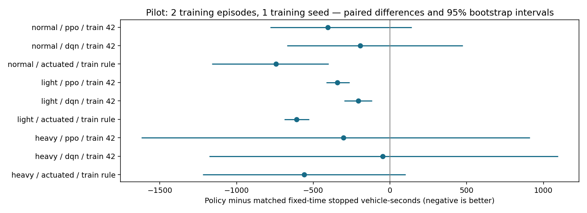
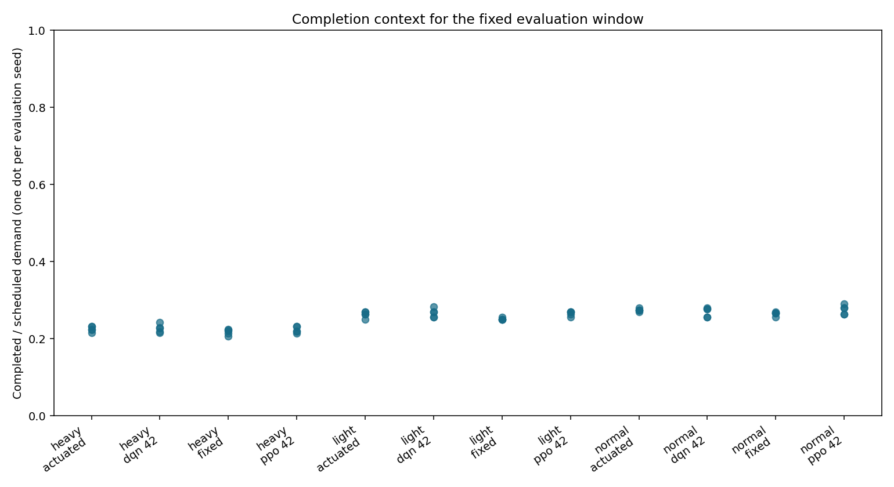

# Pilot: 2 training episodes, 1 training seed

Generated from `raw.csv`; all outcomes retained.

Primary: network stopped vehicle-seconds in the fixed measured window. TripInfo statistics are completed-only; unfinished waits are censored lower bounds.

| Demand | Policy | Train seed | N pairs | Stopped veh-s | Completed fraction | Unfinished | Uninserted | Difference vs fixed | 95% paired CI | Improvement |
|---|---|---:|---:|---:|---:|---:|---:|---:|---|---:|
| heavy | actuated | rule | 5 | 7324.20 | 0.23 | 338.40 | 5.40 | -559.80 | [-1220.60, 101.00] | 7.10% |
| heavy | dqn | 42 | 5 | 7837.00 | 0.23 | 336.20 | 7.00 | -47.00 | [-1179.20, 1096.20] | 0.60% |
| heavy | fixed | rule | 5 | 7884.00 | 0.22 | 340.20 | 7.00 | 0.00 | [0.00, 0.00] | -0.00% |
| heavy | ppo | 42 | 5 | 7581.40 | 0.22 | 338.80 | 6.00 | -302.60 | [-1620.40, 911.20] | 3.84% |
| light | actuated | rule | 5 | 2430.40 | 0.26 | 109.00 | 0.00 | -608.40 | [-689.20, -527.60] | 20.02% |
| light | dqn | 42 | 5 | 2833.00 | 0.27 | 108.40 | 0.00 | -205.80 | [-297.80, -117.20] | 6.77% |
| light | fixed | rule | 5 | 3038.80 | 0.25 | 110.80 | 0.00 | 0.00 | [0.00, 0.00] | -0.00% |
| light | ppo | 42 | 5 | 2696.60 | 0.27 | 108.40 | 0.20 | -342.20 | [-414.80, -263.60] | 11.26% |
| normal | actuated | rule | 5 | 4538.20 | 0.27 | 213.20 | 1.60 | -743.60 | [-1160.20, -400.80] | 14.08% |
| normal | dqn | 42 | 5 | 5086.40 | 0.27 | 215.40 | 0.80 | -195.40 | [-671.80, 475.40] | 3.70% |
| normal | fixed | rule | 5 | 5281.80 | 0.27 | 216.00 | 1.40 | 0.00 | [0.00, 0.00] | -0.00% |
| normal | ppo | 42 | 5 | 4877.60 | 0.28 | 213.00 | 1.40 | -404.20 | [-781.80, 140.00] | 7.65% |

95% percentile bootstrap of paired mean differences, 10000 resamples, seed 42; evaluation seeds only

## Trip and queue context

Each cell averages run-level statistics, including p95/max; these are not pooled trip quantiles. Completed trips exclude censored demand.

| Demand | Policy | Train seed | Controlled queue mean (vehicles) | Completed wait mean (s) | Mean of run p95 waits (s) | Mean of run max waits (s) | Completed duration mean (s) | Unfinished wait lower bound mean (s) |
|---|---|---:|---:|---:|---:|---:|---:|---:|
| heavy | actuated | rule | 13.58 | 8.40 | 35.80 | 79.60 | 131.85 | 17.88 |
| heavy | dqn | 42 | 13.24 | 8.51 | 50.00 | 90.00 | 129.77 | 19.46 |
| heavy | fixed | rule | 11.85 | 8.89 | 58.01 | 84.20 | 125.80 | 19.36 |
| heavy | ppo | 42 | 14.07 | 7.26 | 31.94 | 89.80 | 129.31 | 18.95 |
| light | actuated | rule | 6.02 | 7.40 | 34.67 | 67.60 | 132.94 | 18.30 |
| light | dqn | 42 | 7.08 | 8.19 | 43.06 | 85.40 | 132.62 | 21.80 |
| light | fixed | rule | 7.00 | 8.74 | 55.31 | 77.20 | 132.83 | 23.18 |
| light | ppo | 42 | 6.87 | 7.23 | 41.06 | 85.80 | 134.28 | 20.90 |
| normal | actuated | rule | 9.85 | 6.91 | 28.01 | 75.60 | 131.63 | 17.30 |
| normal | dqn | 42 | 9.81 | 6.96 | 41.38 | 85.80 | 128.48 | 19.66 |
| normal | fixed | rule | 9.84 | 7.56 | 51.58 | 77.80 | 127.81 | 20.35 |
| normal | ppo | 42 | 10.12 | 6.90 | 31.62 | 86.00 | 131.96 | 18.86 |

## Limits

- Pilot or finite training budget; convergence is not established.
- Intervals resample matched evaluation seeds within each training seed; they do not estimate training-seed population uncertainty.
- Completed-only TripInfo waiting/travel times exclude censored unfinished and uninserted trips; inspect completion before comparing them.
- Controlled-lane queue is an incoming-lane snapshot metric, not a whole-network queue or a trip mean.
- Shaped rewards use incoming-count and lane-wait proxies, not movement pressure or measured intersection throughput.
- Derived common plans yellow all released greens and insert all-red. Fixed is this bounded derived plan, not the unmodified source program.
- Original road network is uncalibrated and SUMO reports a never-green source movement; no field traffic claim is supported.

## Provenance

Full configuration, seeds, file hashes, model hashes and actual tool versions are in `manifest.json`. Individual TripInfo and replay files are indexed there.
